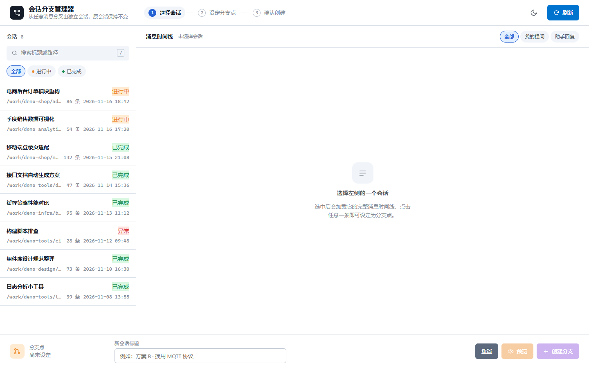
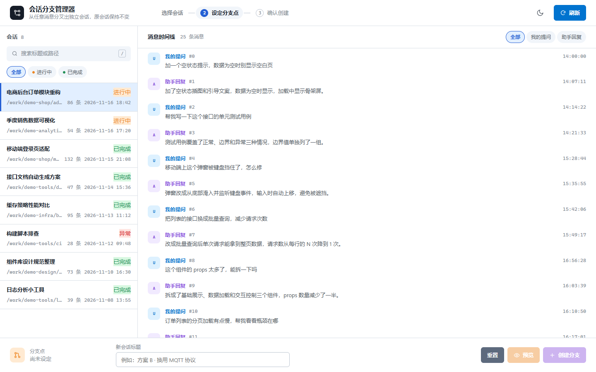
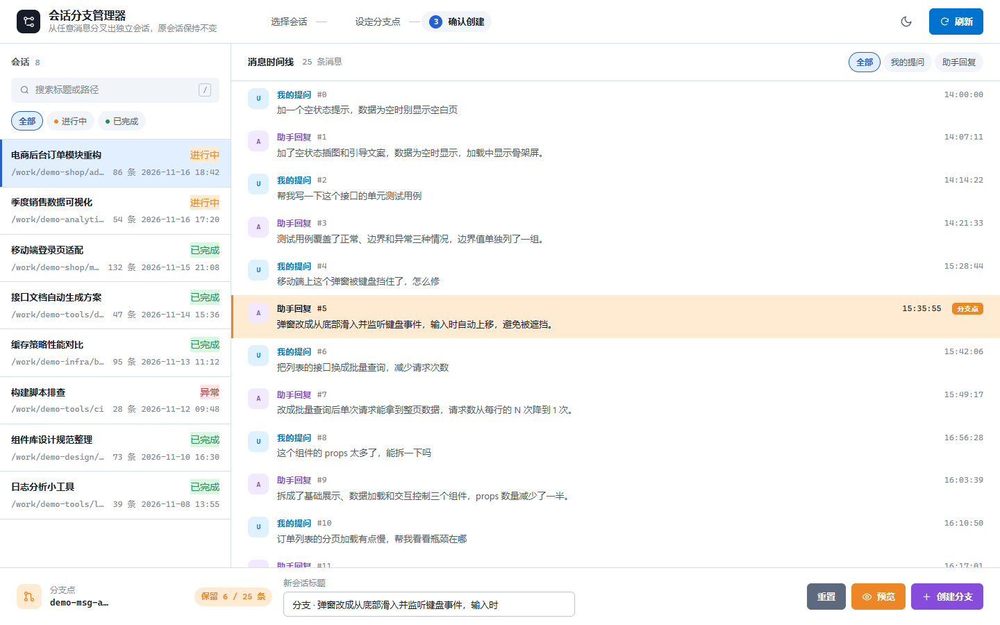
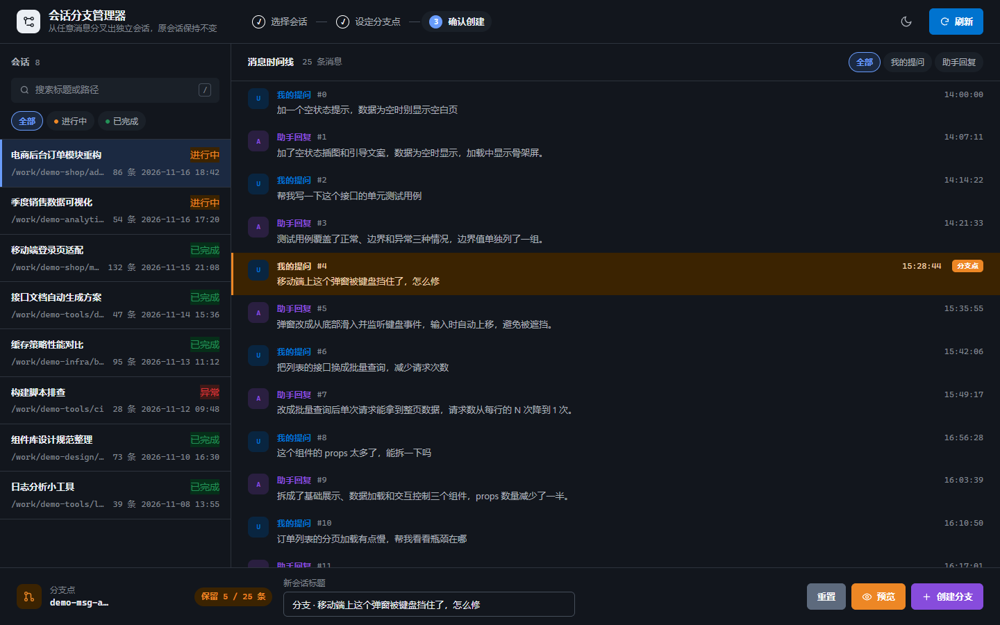
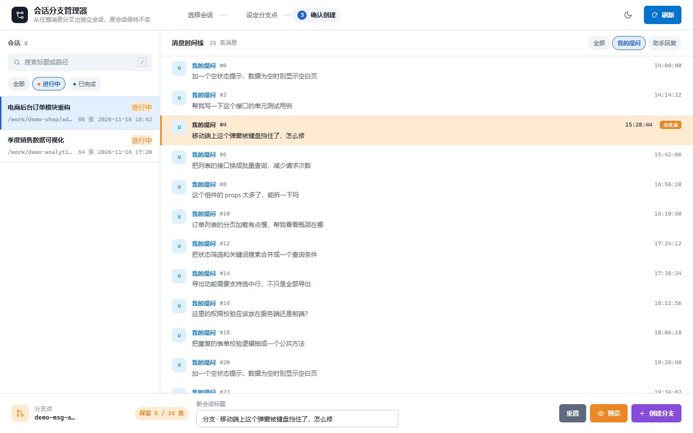

# 会话分支管理器

WorkBuddy 本地会话的分叉工具。**从对话中间任意一条消息复制出一条独立新会话，原会话完整保留。**

> **Rust + Tauri 构建** · Windows x64 单文件 exe 仅 ~4 MB · 原生性能 · 全本地处理
> [下载最新版](https://github.com/MisakaMikoto128/workbuddy-session-branch/releases/latest) · [在线主页](https://misakamikoto128.github.io/workbuddy-session-branch/)

WorkBuddy 的对话在底层是一棵以 `parentId` 串联的消息树，但界面只沿当前叶子回溯显示一条链，没有暴露 Branch 按钮。内置的消息悬停「回退 / 编辑 / 刷新」会覆盖当前视图，旧分支切不回来。这个工具直接操作本地数据，把某条消息之前的上下文复制成一个全新的会话，两条线在侧边栏并存、可随时切换。

<p align="center">
  
</p>
<p align="center"><sub>三步式流程：选择会话 → 设定分支点 → 确认创建，进度始终可见</sub></p>

## 为什么需要它

做长任务时，经常聊到一半想换一个方向试——但 WorkBuddy 没有 Branch 按钮，内置回退会把当前对话改掉，旧路走不回来。这个工具给你真正的选择：**保留已走的路，同时从任意节点开一条新路。**

- 原会话一字不改，新会话带着分支点之前的完整上下文
- 工具调用、推理过程、产物快照随分支点一起保留
- 写库前自动备份 `workbuddy.db`，失败自动回滚

## 三步完成分叉

### 1 · 选择会话

会话列表带状态徽章（进行中 / 已完成 / 异常）和消息条数，支持关键词搜索和状态筛选。选中后右侧加载完整消息时间线。

<p align="center">
  
</p>

### 2 · 设定分支点

在时间线上点任意一条消息，即刻设为分支点：该行高亮并打上标记，底部**当场显示「保留 N 条」**，不用等预览就知道结果。新标题自动从该消息内容生成，可直接改。

<p align="center">
  
</p>

### 3 · 预览并确认

创建前弹出对照：原会话多少条、新会话保留多少条、记录数变化、最终标题。确认后才真正写入。

<p align="center">
  
</p>

创建完成后重启 WorkBuddy，新会话就出现在侧边栏，可以和原会话随时切换。

## 更多界面

<details>
<summary><b>明暗主题</b> — 浅色默认，一键切换深色</summary>

<p align="center">
  
</p>
</details>

<details>
<summary><b>搜索与筛选</b> — 会话按状态过滤，消息按角色过滤</summary>

<p align="center">
  
</p>
</details>

> 以上截图全部来自**虚构演示数据**，不含任何真实会话、路径或用户名。见下方「隐私与演示模式」。

## 功能一览

- 三步流程，进度始终可见
- **会话按工作区（cwd）折叠分组**，组头显示工作区名与会话数，可展开/收起
- 会话搜索 / 状态筛选，消息按角色过滤
- 选分支点即时显示保留数；列表项「分支」按钮可直接从最新消息分叉
- 国内版 / 国际版数据一键切换（`.workbuddy` / `.workbuddy-ai`）
- **跨版本迁移会话**：从一个版本复制到另一个版本，自动适配 user_id、路径风格、会话 ID 与目录，原会话保留
- **软删除 + 撤销**：删除只标记不物理移除，提示条限时撤销
- 启动时检查新版本，提示并跳转下载（数据来自 Release 的 `update.json`）
- 创建前自动备份数据库，失败回滚
- 明暗主题、键盘操作（`/` 搜索、`Ctrl+Enter` 创建、`Esc` 关闭）
- 完整空状态 / 加载骨架 / 错误态，WCAG AA 对比、焦点可见、减少动效偏好

## 安装与运行

直接从 [Releases](https://github.com/MisakaMikoto128/workbuddy-session-branch/releases/latest) 下载 Windows x64 版本：

- `wb-session-branch-windows-x64-onefile.exe` — 单文件版，双击即用（推荐，约 5 MB）
- `wb-session-branch-windows-x64-dir.zip` — 目录版，解压运行

无需安装 Python 或运行时，使用系统自带的 WebView2（Windows 10/11 均已内置）。

**执行前请完全退出 WorkBuddy**，避免写入时与桌面端缓存冲突；创建完成后重启即可看到新会话。

从源码构建需要 Rust 1.77+ 和 tauri-cli：

```bash
cargo install tauri-cli --version '^2'
cd rust && cargo tauri build --no-bundle
# 产物：rust/target/release/wb-session-branch.exe
```

## 隐私与演示模式

工具只读取并复制本机 WorkBuddy 数据，不联网、不上传。README 的所有截图都来自一个隔离的**演示模式**：会话、路径、消息全部虚构（`demo-` 前缀），`do_branch` 在演示模式下为纯内存操作，**绝不接触真实数据库**。

```bash
python src/serve.py --port 8777 --demo
# 浏览器打开 http://127.0.0.1:8777/
```

不带 `--demo` 则是旧版 Python 后端（保留用于回归测试），默认连 `~/.workbuddy-ai`。正式发布版是 Rust/Tauri，两种数据版本都支持。

浏览器测试服务 `serve.py` 用标准库 HTTP 暴露接口并注入兼容 shim，前端 `api()` 自动识别环境：桌面版走 Tauri `invoke`，浏览器走 fetch，同一份前端代码两边都能跑。

## 测试

```bash
python src/serve.py --port 8777        # 或 --demo
python tests/test_ui.py                # 另开终端
```

## Windows 自动编译与更新管理

`.github/workflows/build-windows.yml` 在推送 `v*` tag 或手动触发时，用 Tauri 在 `windows-latest` 上编译，产出：

- `wb-session-branch-windows-x64-onefile.exe` — 单文件版
- `wb-session-branch-windows-x64-dir.zip` — 目录版
- `update.json` — 版本、发布日期、各产物的 SHA256 与大小

exe 版本号由 `build.rs` 从 git tag 注入，保证与发布 tag 一致；应用启动时读取 `update.json` 检查新版本。

```bash
git tag v2.1.0
git push origin v2.1.0
```

## 项目结构

```
rust/
  src/core.rs      分支核心逻辑（rusqlite + JSONL 树，双版本数据）
  src/main.rs      Tauri commands（含 check_update）
  build.rs         从 git tag 注入版本号
  tauri.conf.json  Tauri 配置
src/web/index.html 前端界面（设计 token + 三步流程 + 工作区分组）
src/               旧版 Python 后端（仅用于浏览器回归测试）
  wb_branch.py / app.py / serve.py / demo_data.py
tests/test_ui.py   回归测试
assets/            原创 logo 与多尺寸图标
docs/site/         GitHub Pages 下载页
docs/screenshots/  README 配图（全部演示数据）
.impeccable.md     设计上下文与设计原则
```

## License

MIT — 详见 [LICENSE](LICENSE)。
